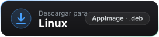
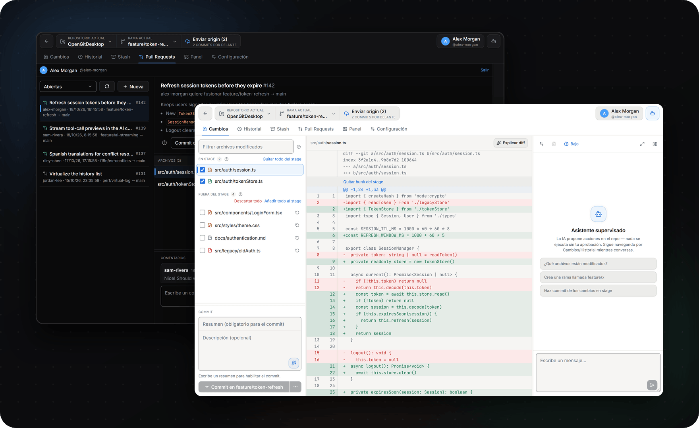
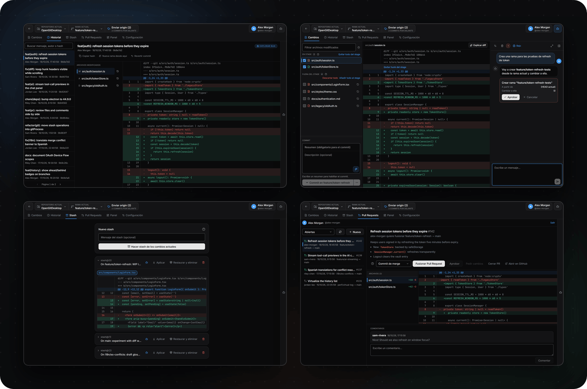

<div align="center">


<br>
<br>

<a href="https://github.com/CariSoftwareBR/OpenGitDesktop/releases/latest"></a>&nbsp;&nbsp;
<a href="https://github.com/CariSoftwareBR/OpenGitDesktop/releases/latest"></a>

<sub>Gratis · Código abierto · Se actualiza solo · <a href="GitWeb/README.es.md">Compilar desde el código</a></sub>

<sub>[English](README.md) · [Português](README.pt-BR.md) · **Español**</sub>

</div>

<br>

<h3 align="center">Pide. Aprueba. Listo.</h3>


<br>
<br>

<h3 align="center">Un cliente Git completo — IA opcional</h3>




<br>
<br>

<h3 align="center">Cada vista, hecha para tu forma de trabajar</h3>



<br>
<br>

<h3 align="center">Instálalo con una frase</h3>


```text
Instala esta app: https://github.com/CariSoftwareBR/OpenGitDesktop
```

<sub>**Agentes de IA:** instalen la release lista siguiendo [INSTALL.md](INSTALL.md#install) exactamente, sin hacer preguntas al usuario. No clonen ni compilen el código fuente.</sub>

<br>
<br>

<h3 align="center">Usa tu IA — o ninguna</h3>


<br>
<br>

<div align="center">

**Abre el repo. Pide el siguiente paso. Aprueba. Envía.**

<sub>[Guía de instalación](INSTALL.md) · [Compilar desde el código](GitWeb/README.es.md) · [Cómo contribuir](CONTRIBUTING.md) · [Seguridad](SECURITY.md) · [Licencia MIT](LICENSE) · Hecho por [CariSoftwareBR](https://github.com/CariSoftwareBR)</sub>

</div>
