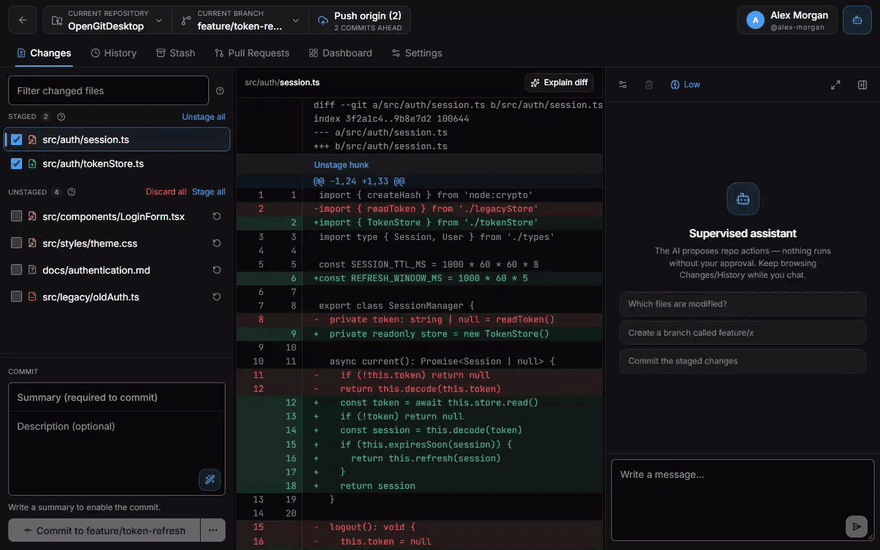
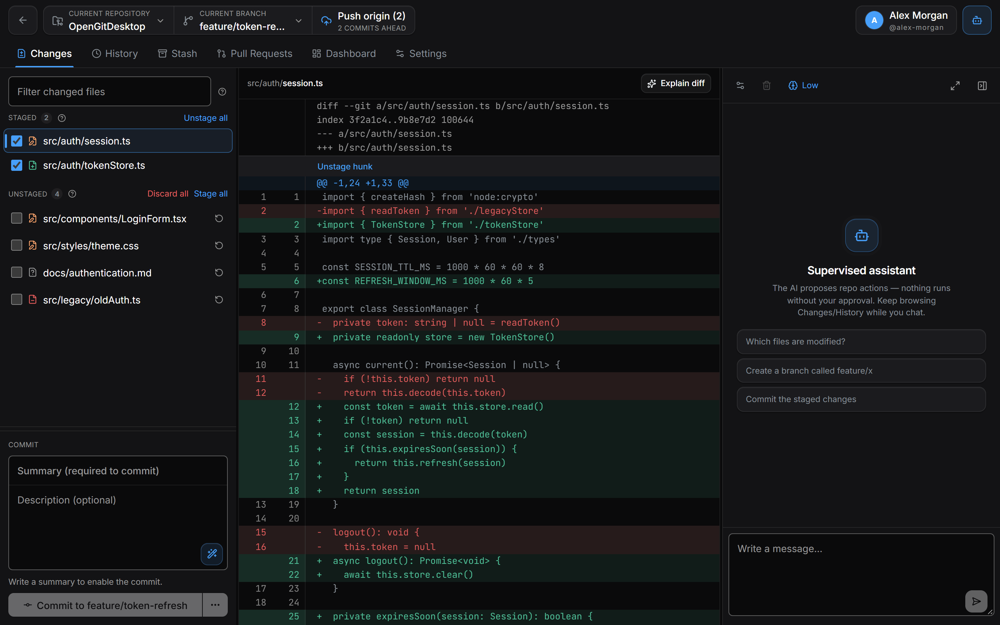
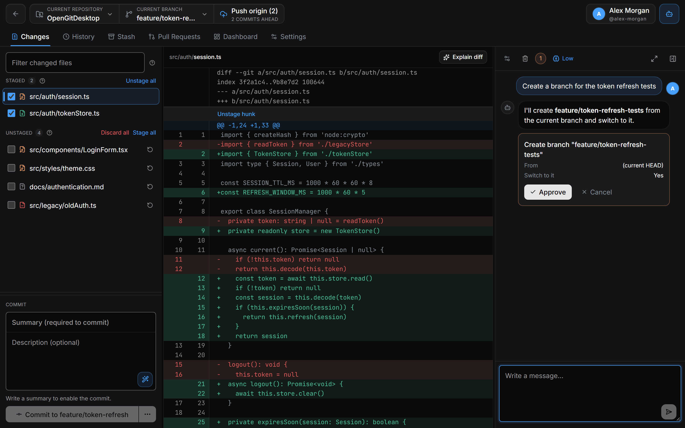
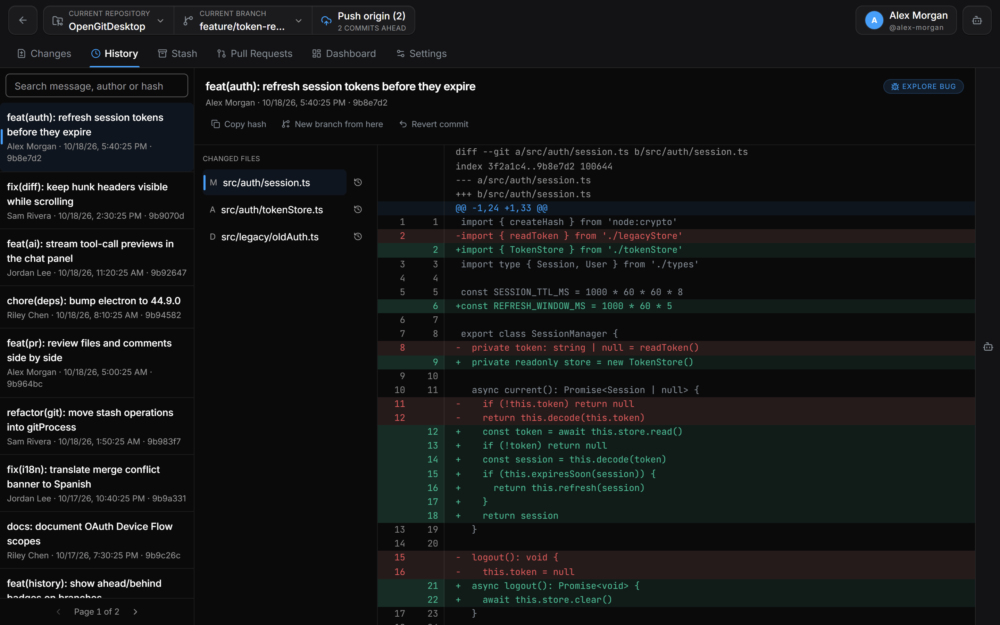
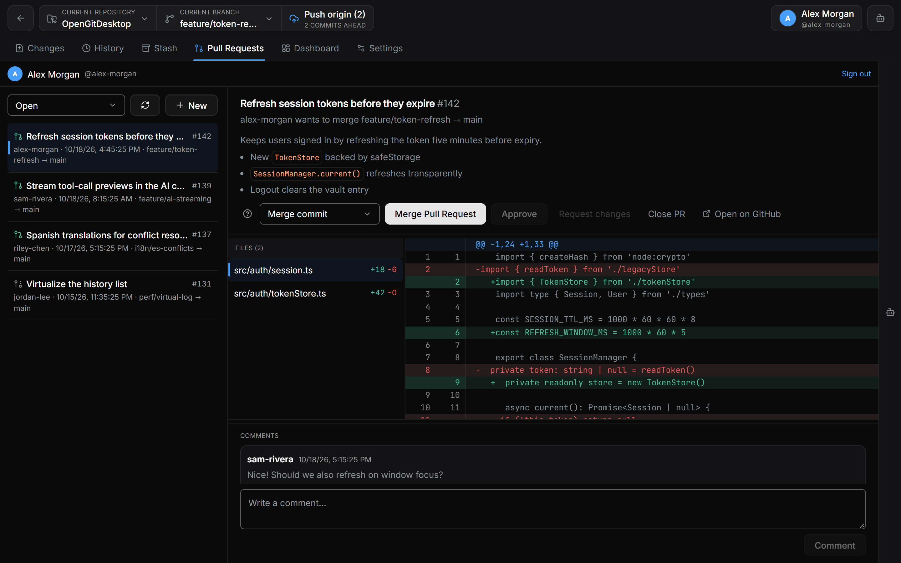
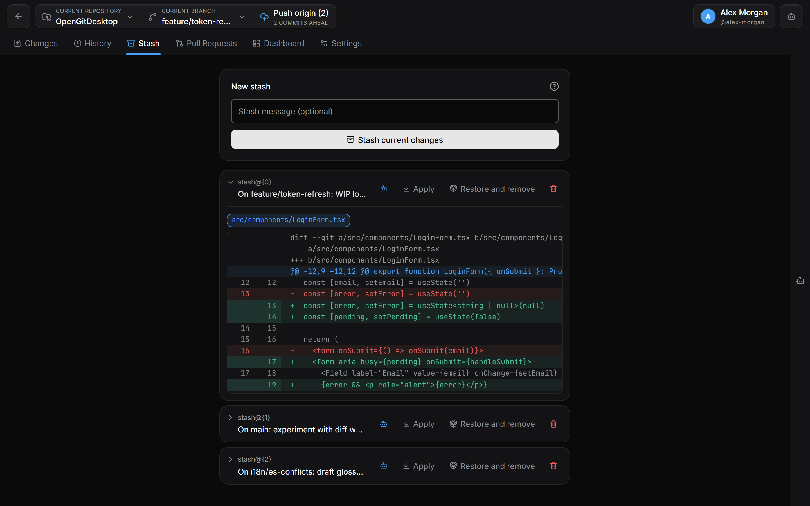
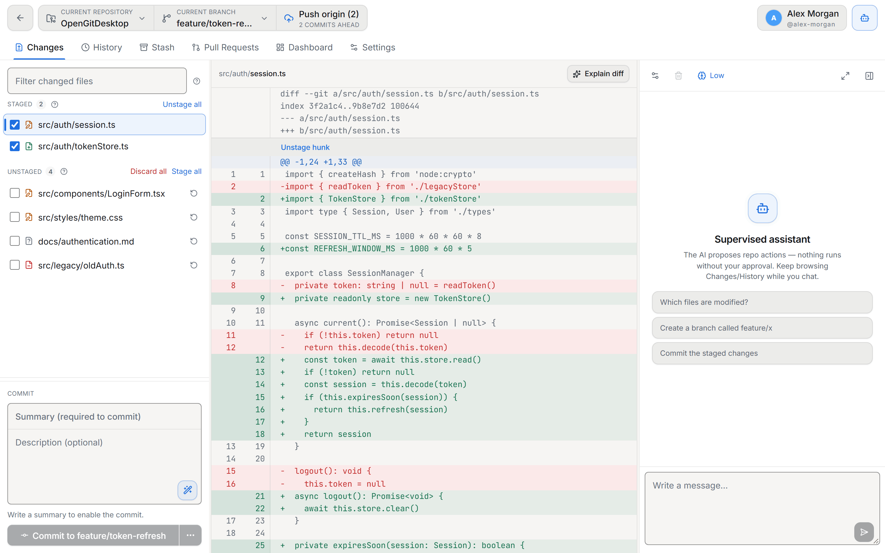

<div align="center">


<br>
<br>

**English** · [Português](README.pt-BR.md) · [Español](README.es.md)

<br>

[](https://github.com/CariSoftwareBR/OpenGitDesktop/releases)
[](GitWeb/README.en.md)
[](https://github.com/CariSoftwareBR/OpenGitDesktop/releases)
<br>
[](https://github.com/CariSoftwareBR/OpenGitDesktop/releases)
[](LICENSE)
[](GitWeb/README.en.md)
[](GitWeb/README.en.md)
[](GitWeb/README.en.md)

</div>

<br>

<h2 align="center">🎬 See it in action</h2>

<p align="center">Ask in plain language. The assistant proposes a real Git action. <b>Nothing happens until you click Approve.</b></p>

<p align="center">

</p>

<br>

<h2 align="center">🧭 How it works</h2>



There are great Git clients. There are great AI agents. Almost none brings the two together the right way.

| | GUI only | Agent only | **OpenGitDesktop** |
|---|:---:|:---:|:---:|
| **Who acts** | You click everything | The AI acts alone | You talk — and **approve** every action |
| **Speed** | 🐢 Slow | ⚡ Fast | ⚡ Fast |
| **Safety** | ✅ Safe | ⚠️ Risky | ✅ Safe |

The difference isn't “having AI”. It's **tool-calling with mandatory human approval**: the AI proposes a branch, commit, push, stash, PR… and nothing touches the repository until you say yes.

<br>

<h2 align="center">💙 Why you'll love it</h2>

<table>
<tr>
<td width="33%" valign="top">

### 🛡️ You're in charge
Every AI action shows a preview and waits for **Approve**. No agent running loose in your history.

</td>
<td width="33%" valign="top">

### 🔁 The full workflow
Clone, stage by hunk, commit, branch, merge, resolve conflicts, stash, push — from clone to merge.

</td>
<td width="33%" valign="top">

### 🐙 Pull Requests built in
List, create, review files and comments, approve, merge, close or reopen — right next to your code.

</td>
</tr>
<tr>
<td valign="top">

### ✍️ AI that helps, not hijacks
Commit messages from what actually changed, “Explain diff”, PR drafts and reviews — all optional.

</td>
<td valign="top">

### 🔐 Local-first
Tokens and API keys live in your OS vault (`safeStorage`). The UI never even sees your GitHub token.

</td>
<td valign="top">

### 🌍 Speaks your language
English, Português (Brasil) and Español — the UI, the errors and the AI's replies. Dark, light and high-contrast themes.

</td>
</tr>
</table>

<br>

<h2 align="center">🖼️ Take the tour</h2>

<table>
<tr>
<td width="50%" valign="top">

<p align="center"><b>Changes</b><br><sub>Stage per file or per hunk, crisp diffs, AI-written commit messages.</sub></p>
</td>
<td width="50%" valign="top">

<p align="center"><b>Supervised assistant</b><br><sub>Each proposed action shows exactly what will run. Approve or cancel.</sub></p>
</td>
</tr>
<tr>
<td valign="top">

<p align="center"><b>History</b><br><sub>Search the log, inspect any commit, branch from it or revert it.</sub></p>
</td>
<td valign="top">

<p align="center"><b>Pull Requests</b><br><sub>Review files, comment, approve and merge without leaving the app.</sub></p>
</td>
</tr>
<tr>
<td valign="top">

<p align="center"><b>Stash</b><br><sub>Put work aside, preview it, bring it back with conflict detection.</sub></p>
</td>
<td valign="top">

<p align="center"><b>Light theme</b><br><sub>Follows your system — or pick dark, light or high contrast in Settings.</sub></p>
</td>
</tr>
</table>

<br>

<h2 align="center">🤖 The assistant, up close</h2>

<p align="center">It isn't a decorative chatbot. It's a supervised operator for your Git.</p>

<table>
<tr>
<td width="50%" valign="top">

#### ✅ It can
- Create, switch and merge branches
- Write the message and commit
- Push, pull and fetch
- Stash / stash pop
- List and create pull requests
- Help review and merge PRs (dedicated skills)
- Explain a diff, a commit or an error

</td>
<td width="50%" valign="top">

#### 🚫 It can't
- Write to the repository without your approval
- Act on several repos at once — only the one that's open
- Send your keys anywhere: API keys and tokens stay in the OS vault
- Become a requirement — the full GUI works with no AI configured

</td>
</tr>
</table>


<br>

<h2 align="center">🔐 GitHub sign-in that just works</h2>

| | |
|---|---|
| **OAuth Device Flow** | Click “Continue with GitHub”, confirm the code at `github.com/login/device` — done. |
| **Personal Access Token** | For github.com or GitHub Enterprise Server. |

The token works for the API **and** for the `git` CLI (HTTPS clone/fetch/pull/push) — no separate Credential Manager setup for GitHub remotes. SSH keeps using your system config, untouched.

Credentials are encrypted via Credential Manager / Keychain / libsecret and never written to the repo. The token stays in the main process: the interface never receives it, it only asks for operations. Scopes, isolation and revocation are detailed in [GitWeb/README.en.md](GitWeb/README.en.md#github-authentication).

<br>

<h2 align="center">🚀 Get started</h2>

**Download** the installer from [**Releases**](https://github.com/CariSoftwareBR/OpenGitDesktop/releases) — `.exe` for Windows, `.AppImage` / `.deb` for Linux. The app updates itself. On **macOS**, build from source for now (`npm run build:mac`).

> [!WARNING]
> **Release binaries are not code-signed yet.** Windows will show a SmartScreen warning on first launch. The auto-updater checks the SHA-512 hash published with each release, but there is no signing chain — if that's unacceptable for you, build from source.

**Or build from source** — you need Node.js 20+ and Git on the `PATH`:

```bash
git clone https://github.com/CariSoftwareBR/OpenGitDesktop.git
cd OpenGitDesktop/GitWeb
npm install
npm run dev
```

<details>
<summary><b>📦 Packaging installers</b></summary>
<br>

```bash
npm run build        # bundle in out/
npm run build:win    # Windows (.exe / NSIS)
npm run build:mac    # macOS (.dmg / .zip)
npm run build:linux  # Linux (.AppImage / .deb)
```

On Windows, building the NSIS installer locally needs **Developer Mode** (symbolic links). The app in `npm run dev` or `dist/win-unpacked/` runs fine without it.

</details>

<br>

<h2 align="center">🧱 Under the hood</h2>

<details>
<summary><b>Stack and project layout</b></summary>
<br>

| Area | Technology |
|---|---|
| Desktop | Electron |
| UI | React · TypeScript · Zustand · Tailwind · lucide-react |
| Build | electron-vite · electron-builder |
| Git | System Git CLI (`child_process` in main) |
| GitHub | REST API + OAuth Device Flow / PAT |
| AI | OpenAI · Claude · OpenRouter · Ollama · local |
| Security | Electron `safeStorage` |

```text
GitWeb/src/
├─ main/       → git, credentials, IPC, settings, device flow
├─ preload/    → typed bridge to the renderer
├─ shared/     → shared types and translations (i18n/)
└─ renderer/   → views, stores, GitHub client, AI tools
```

Deeper technical docs: [`GitWeb/README.en.md`](GitWeb/README.en.md).

</details>

<br>

<h2 align="center">❓ Questions</h2>

<details>
<summary><b>Do I need an AI provider to use it?</b></summary>
<br>
No. The Git client is complete on its own. The assistant is an accelerator you can switch on later in Settings.
</details>

<details>
<summary><b>Can the AI change my repository by itself?</b></summary>
<br>
No. Every action that writes — branch, commit, push, stash, merge, PR — is shown as a card with a preview and waits for you to click <b>Approve</b>.
</details>

<details>
<summary><b>Where are my tokens and API keys stored?</b></summary>
<br>
In your operating system's vault (Credential Manager, Keychain or libsecret) through Electron's <code>safeStorage</code>. Never in the repository, never in plain text.
</details>

<details>
<summary><b>Can I run the AI fully offline?</b></summary>
<br>
Yes — point it at <b>Ollama</b> or any local OpenAI-compatible endpoint and nothing leaves your machine.
</details>

<details>
<summary><b>Which Git does it use?</b></summary>
<br>
The one installed on your system — the same Git you trust in the terminal, with your config, hooks and SSH keys.
</details>

<br>

<h2 align="center">🧭 What we believe</h2>

<table>
<tr>
<td align="center" width="25%"><h3>🎛️</h3><b>You're in charge</b><br><sub>Every AI action on Git goes through explicit approval.</sub></td>
<td align="center" width="25%"><h3>🧩</h3><b>AI is optional</b><br><sub>The Git client has to be excellent on its own.</sub></td>
<td align="center" width="25%"><h3>🏠</h3><b>Local-first</b><br><sub>Tokens and keys stay on your machine, in the system vault.</sub></td>
<td align="center" width="25%"><h3>🌳</h3><b>Real Git</b><br><sub>The Git installed on your system, not a reimplementation.</sub></td>
</tr>
</table>

<br>

<div align="center">

### 🤝 Contributing

Issues and pull requests are welcome. Read the [contributing guide](CONTRIBUTING.md) (in Portuguese) and the [Code of Conduct](CODE_OF_CONDUCT.md).<br>
Security issues follow [`SECURITY.md`](SECURITY.md).

<br>

**Open the repo. Ask for the next step. Approve. Push.**<br>
<sub>Git at the pace of a conversation — with you always in control.</sub>

<br>
<br>

<sub>[MIT](LICENSE) · Made by [CariSoftwareBR](https://github.com/CariSoftwareBR)</sub>

</div>
