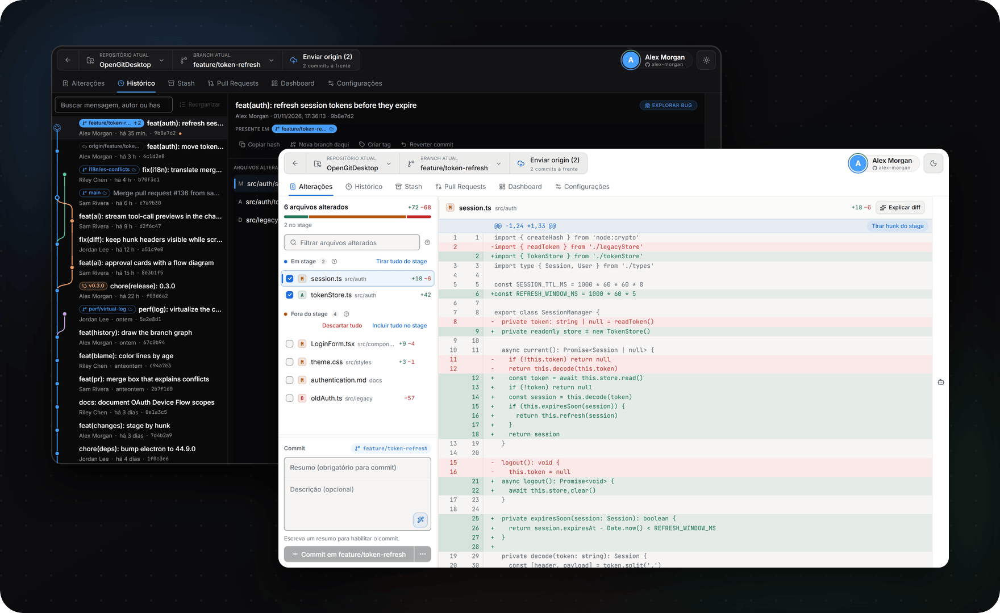
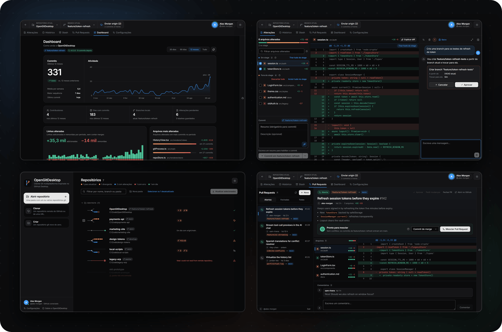

<div align="center">


<br>
<br>

<a href="https://github.com/CariSoftwareBR/OpenGitDesktop/releases/latest"></a>&nbsp;&nbsp;
<a href="https://github.com/CariSoftwareBR/OpenGitDesktop/releases/latest"></a>&nbsp;&nbsp;
<a href="https://github.com/CariSoftwareBR/OpenGitDesktop/releases/latest"></a>

<sub>Grátis · Código aberto · Atualiza sozinho · <a href="GitWeb/README.md">Compilar do código-fonte</a></sub>

<sub>[English](README.md) · **Português** · [Español](README.es.md)</sub>

[](https://buymeacoffee.com/pcarinhena)

</div>

<br>

<h3 align="center">Peça. Aprove. Pronto.</h3>


<br>
<br>

<h3 align="center">Um cliente Git completo — IA opcional</h3>




<br>
<br>

<h3 align="center">Cada tela, feita para o seu jeito de trabalhar</h3>



<br>
<br>

<h3 align="center">Instale com uma frase</h3>


```text
Instale este app: https://github.com/CariSoftwareBR/OpenGitDesktop
```

<sub>**Agentes de IA:** instalem seguindo o [INSTALL.md](INSTALL.md#install) exatamente. No Windows e no Linux, sem perguntas e sem compilar; no macOS, perguntem uma vez: `.dmg` pronto ou compilar do código-fonte.</sub>

<br>
<br>

<h3 align="center">Use a sua IA — ou nenhuma</h3>


<br>
<br>

<div align="center">

**Abra o repo. Peça o próximo passo. Aprove. Envie.**

<sub>[Guia de instalação](INSTALL.md) · [Compilar do código-fonte](GitWeb/README.md) · [Como contribuir](CONTRIBUTING.md) · [Segurança](SECURITY.md) · [Licença MIT](LICENSE) · Feito por [CariSoftwareBR](https://github.com/CariSoftwareBR)</sub>

</div>
